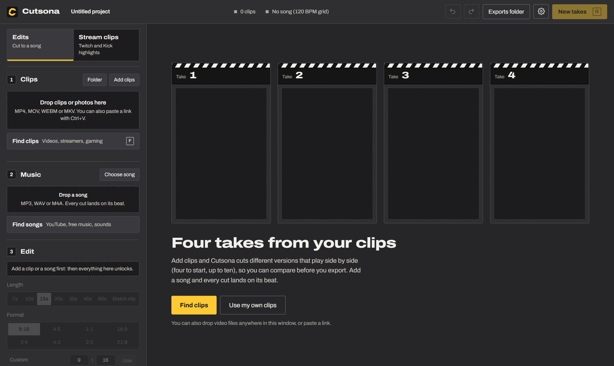

<b>Turn your clips and a song into beat-synced edits.</b> 
Cutsona cuts four different versions at once, plays them side by side, and exports the one you like.

<a href="https://github.com/Cutsona/Cutsona/releases/latest"><b>Download for Windows</b></a> · <a href="docs/GUIDE.md">Guide</a> · <a href="LICENSE">MIT license</a>

## What it does

- **Four takes at once.** Add clips and a song, and Cutsona cuts four different edits that play live, side by side. Don't like one? Press **⟳** for a new take.
- **Cuts on the beat.** Every cut, zoom and effect lands on the song's beats and drops.
- **Clips Twitch and Kick streams.** **Stream clips** finds a stream's best moments (starting with the ones viewers already clipped) and turns each into a clip ready to post: streamer's cam on top, dead air cut out, word-by-word captions and a title. **Export all** saves every one of them.
- **Finds clips and songs for you.** YouTube, Twitch and Kick clips, exact movie moments, gaming, news and free stock footage, plus free music.
- **Tells you what might get claimed.** The copyright check shows who owns each clip and song, how likely a post is to be muted or taken down, and the credits to paste.
- **Fits TikTok, Reels and Shorts.** Safe zones show where each app's buttons and captions will cover your video.
- **Finishes the video.** Captions, watermarks, keyframes and fades, then an MP4 from 360p to 4K.
- **Keeps your work.** Save projects and open them again later, with undo and redo for everything.

## Install

Cutsona runs on Windows 10 and 11.

1. Download **Cutsona-Setup** (the .exe file) from the [latest release](https://github.com/Cutsona/Cutsona/releases/latest).
2. Open it. Cutsona installs for your account (no admin needed) and opens.

That's it: FFmpeg and yt-dlp come with it, and new versions arrive through the **Update** button in the app.

> **"Windows protected your PC"?** The installer isn't code-signed yet, so Windows doesn't know it. Press **More info**, then **Run anyway**. Everything Cutsona does is in this repository for anyone to check.

For captions, open **Settings → Captions and speech** and press **Set up speech tools** once (it needs [Python](https://www.python.org/downloads/)).

## Use it

1. **Add clips.** Drop video files in, or press **Find clips**.
2. **Add a song.** Drop an MP3, or press **Find songs**.
3. **Pick a take and export it.** Your MP4 is saved to `Videos\Cutsona`, which you can change in **Settings**.

Clipping a stream instead? Switch to **Stream clips** at the top left, then paste a Twitch or Kick link, or pick one in **Find clips → Streamers**.

| Key | What it does |
| --- | --- |
| Space | Play or pause |
| G | New takes of all four |
| R | New take of the selected one |
| E | Export the selected one |
| Ctrl+Z / Ctrl+Y | Undo / redo |
| Ctrl+S | Save the project |

## Open source

Cutsona is free and open source under the [MIT license](LICENSE). Bug reports, ideas and pull requests are welcome: [CONTRIBUTING.md](CONTRIBUTING.md) shows how to run it from the code. It's built on FFmpeg, yt-dlp, Electron, MediaPipe and Whisper ([third-party notices](THIRD-PARTY-NOTICES.md)).

Clips and songs belong to the people who made them. You're responsible for what you download and post.
