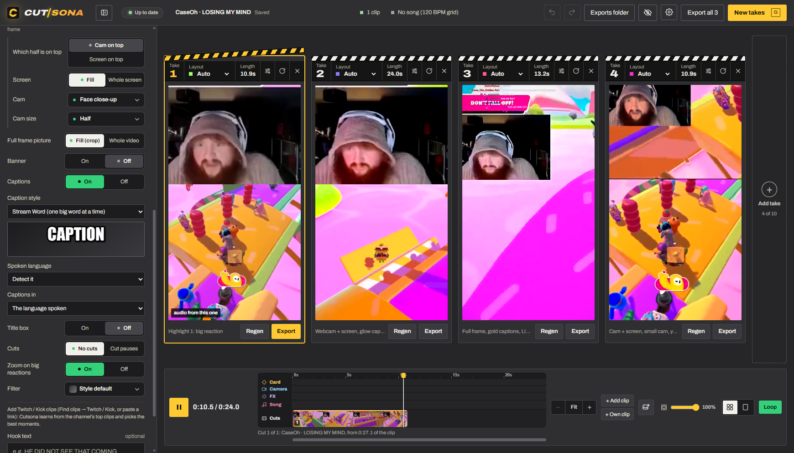
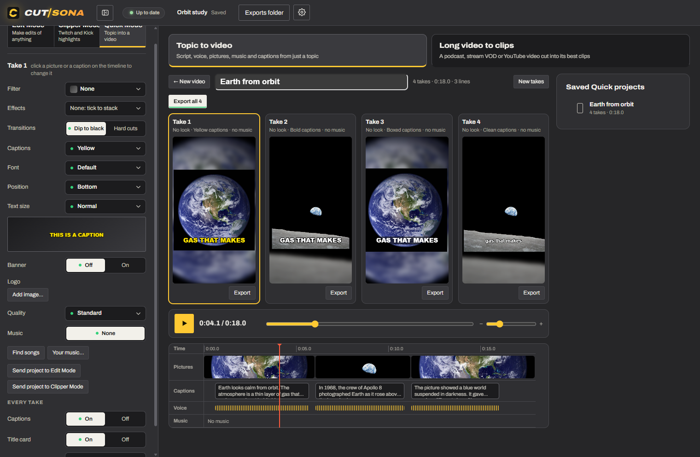

<p align="center"></p>

<p align="center"><strong>Beat-synced edits, stream highlights, and narrated videos on Windows.</strong><br>
Preview takes side by side, refine the cuts on a timeline, and export the one you want.</p>

<p align="center"><a href="https://github.com/Cutsona/Cutsona/releases/latest"><strong>Download for Windows</strong></a> · <a href="#install-from-powershell">PowerShell install</a> · <a href="docs/GUIDE.md">User guide</a></p>


## Install on Windows

Cutsona runs on 64-bit Windows 10 and 11. Download and open the `Cutsona-Setup-*.exe` for the latest version. The installer runs for your account and includes FFmpeg and yt-dlp. [Latest release](https://github.com/Cutsona/Cutsona/releases/latest)

### Install from PowerShell

Run this in **PowerShell** or the PowerShell tab in **Windows Terminal**. It downloads the latest stable installer, verifies its SHA-256 against GitHub's release metadata, and opens it. [View the installer script](tools/install.ps1)

```powershell
& ([scriptblock]::Create((irm 'https://raw.githubusercontent.com/Cutsona/Cutsona/main/tools/install.ps1')))
```

## Choose a mode

| Mode | What you can make |
| --- | --- |
| **Edit Mode** | Beat-synced videos from your clips and a song. Adjust cuts, framing, captions, filters, and keyframes on the timeline. |
| **Clipper Mode** | Twitch and Kick highlights with portrait layouts, facecam framing, and word-by-word captions. Export one take or all highlights. |
| **Quick Mode** | Turn a topic or script into a narrated video, or find the highlights in a long video. Reopen a saved project or send its takes to either editor. |

### Clipper Mode



### Quick Mode



Demo footage in the screenshots uses NASA's [Blue Marble](https://science.nasa.gov/resource/blue-marble-2002/) and [Apollo 8 Earthrise](https://images.nasa.gov/details/as08-14-2383).

## Editing tools

- **Find Clips** searches videos, streamer clips, exact moments, gaming, news, and stock footage. Preview and trim a clip before adding it.
- **Find Songs** shows track previews and waveforms. You can use your own audio too.
- **Caption style previews and safe zones** show how text looks and where platform controls might cover it.
- **Saved projects** keep your takes, cuts, and settings. Edit Mode and Clipper Mode export MP4s from 360p to 4K.

For automatic captions on local videos, open **Settings → Captions and speech** and choose **Set up speech tools**. [User guide](docs/GUIDE.md#captions)

## Source and credits

Cutsona is licensed under MIT. [License](LICENSE) · [Contributing](CONTRIBUTING.md) · [Third-party notices](THIRD-PARTY-NOTICES.md)
