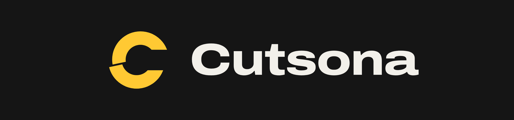

<p align="center"></p>

<p align="center"><b>Turn your clips and a song into beat-synced edits.</b><br>
Cutsona cuts four different versions at once, plays them side by side, and exports the one you like.</p>

<p align="center"></p>

## What it does

- **Four takes at once.** Add clips and a song, and Cutsona cuts four different edits that play live, side by side. Don't like one? Press **⟳** for a new take.
- **Cuts on the beat.** Every cut, zoom and effect lands on the song's beats and drops.
- **Clips Twitch and Kick streams.** **Stream clips** finds a stream's best moments (starting with the ones viewers already clipped) and turns each into a clip ready to post: laid out for phones with the streamer's cam on top, dead air cut out, word-by-word captions and a title.
- **Finds clips and songs for you.** YouTube, Twitch and Kick clips, exact movie moments, gaming, news and free stock footage, plus free music.
- **Keeps people in frame.** When a wide clip goes vertical, auto-framing follows the person in it.
- **Finishes the video.** Captions, watermarks, keyframes and fades, then export an MP4 from 360p to 4K.
- **Updates itself.** When a new version is out, an **Update** button shows what's new and installs it.

## Install

Cutsona runs on Windows 10 and 11.

1. Open **PowerShell**: press Start, type `PowerShell`, press Enter.
2. Paste this and press Enter:

   ```powershell
   irm https://raw.githubusercontent.com/Cutsona/Cutsona/main/install.ps1 | iex
   ```

The installer gets whatever's missing (Git, Node.js, FFmpeg and the speech tools for captions), puts Cutsona in your user folder, adds it to your Desktop and Start menu, and opens it. The first install takes a few minutes.

Already have the Cutsona folder? Double-click **Install.cmd** inside it.

## Use it

1. **Add clips.** Drop video files in, or press **Find clips**.
2. **Add a song.** Drop an MP3, or press **Find songs**.
3. **Pick a take and export it.** Your MP4 is saved to the exports folder, which you can change in **Settings**.

Clipping a stream instead? Switch to **Stream clips** at the top left, then paste a Twitch or Kick link, or pick one in **Find clips → Streamers**.

| Key | What it does |
| --- | --- |
| Space | Play or pause |
| G | New takes of all four |
| R | New take of the selected one |
| E | Export the selected one |

## More

- [Guide](docs/GUIDE.md): every feature, framing, captions, and how Cutsona picks moments
- [Running the repo](docs/MAINTAINING.md): publishing updates and the logo files

See the [license](LICENSE) for how Cutsona may be used. It's built on open-source tools like FFmpeg, yt-dlp and Whisper; the full list is in **Settings → Credits**. You're responsible for the clips you download and post.
